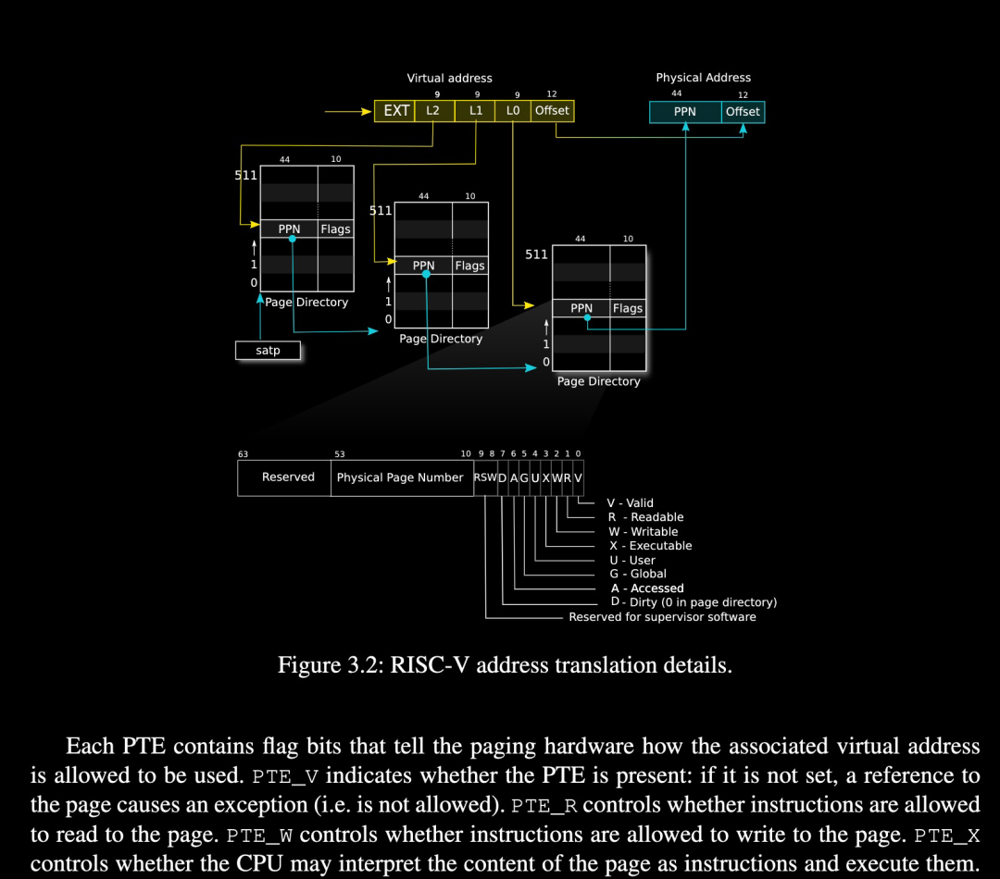
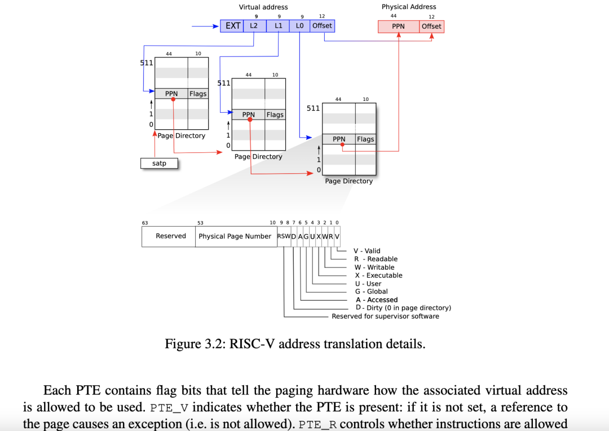

# Darkpdf

PDF viewer for VS Code with an adjustable dark mode, based on [pdf.js](https://mozilla.github.io/pdf.js/) and [vscode-pdfviewer](https://github.com/tomoki1207/vscode-pdfviewer).

Source: https://github.com/PotatoZhou/darkpdf

## Screenshots

Dark theme:



Light theme:



## Features

- Inversion slider in the toolbar, from 0 (original colors) to 100 (fully inverted).
- Theme presets: dark, original, sepia, contrast, plus user-defined themes.
- Custom themes are easy to add via the `darkpdf.themes` setting; each theme has a `name` and optional numeric `hue`, `saturation`, `brightness`, `contrast`, `sepia`, `invert` fields plus `paperColor`. See [Custom themes](#custom-themes) below.
- The theme menu button at the far right of the toolbar opens a popup with all presets, your themes and a Help entry that opens this README; `Ctrl+Shift+Z` cycles through them while the PDF has focus.
- Optional image-preserving inversion (`darkpdf.default.keepImageColor`): colored images keep their original colors, pages are inverted on a separate canvas layer.
- The dark theme covers the toolbar; the toolbar can auto-hide until hovered, and a lock button on the toolbar keeps it visible.
- Zoom, page and theme are remembered per document (`darkpdf.default.restoreState`).
- Status bar shows the inversion level; click it to pick a theme or set the inversion.
- Page navigation commands, copy current page text, print and PNG export.

## Keyboard

| Shortcut | Action |
| --- | --- |
| `Ctrl+Shift+Z` | Cycle through the theme presets, handled inside the viewer |
| `d` | Same as above, while the PDF has focus |
| `Ctrl+=` / `Ctrl+-` / `Ctrl+0` | Zoom in / out / reset |
| `Alt+PageDown` / `Alt+PageUp` | Next / previous page |
| `Alt+Home` / `Alt+End` | First / last page |
| `Ctrl+G` | Go to page (focuses the page number box) |
| `Ctrl+Alt+C` | Copy the current page text |
| `n` / `p` / `g` / `G` | Next / previous / first / last page |

All shortcuts above work while the PDF has focus. Zoom and navigation commands are also available from the Command Palette when focus is outside the viewer. PDF.js keeps its own shortcuts for scrolling, page up/down, rotation and find. The viewer does not bind `Ctrl+P`; use the "Dark PDF: Print…" command instead.

## Using themes

1. Open a `.pdf`. The viewer starts with `darkpdf.default.theme` (`dark` by default).
2. Pick a theme from any of these places:
   - The far-right **Theme** button in the toolbar: a menu with all presets, every theme from `darkpdf.themes`, and **Help** (opens this README).
   - The inversion percentage in the VS Code status bar, or the Command Palette command **Dark PDF: Choose Theme / Inversion…**: includes **Set inversion…** for a 0–100 value.
   - The Command Palette command **Dark PDF: Cycle Theme**, `Ctrl+Shift+Z`, or `d`: cycle to the next theme while the PDF has focus.
3. Use the toolbar slider to set inversion from `0` (original colors) to `100`. `Original` forces `0`; the other themes restore the last dark level.
4. If the toolbar is hidden, hover over it or click its lock button to keep it visible.

Changing `darkpdf.default.*` or `darkpdf.themes` in Settings refreshes open previews. When `darkpdf.default.restoreState` is `true`, a document's saved theme wins over the default until you choose a theme for that document.

## Settings

| Setting | Default | Description |
| --- | --- | --- |
| `darkpdf.default.theme` | `dark` | Starting theme preset: a built-in name or one from `darkpdf.themes`. |
| `darkpdf.themes` | `[]` | User-defined theme presets: `{ "name": "night", "hue": 180, "saturation": 1.5, "brightness": 0.9, "contrast": 1.25, "paperColor": "#102030" }`. |
| `darkpdf.default.paperColor` | `""` | Paper color for the `custom` preset, e.g. `#f4ecd8`. |
| `darkpdf.default.customFilter` | `""` | Extra CSS `filter` for the `custom` preset, e.g. `sepia(0.4) contrast(1.1)`. |
| `darkpdf.default.keepImageColor` | `false` | Invert only neutral pixels so colored images stay intact. |
| `darkpdf.default.restoreState` | `true` | Remember zoom, page and theme per document. |
| `darkpdf.default.colorMode` | `true` | Start the preview in dark mode. |
| `darkpdf.default.invert` | `100` | Starting darkness, from `0` (original colors) to `100` (fully inverted). |
| `darkpdf.default.autoHideToolbar` | `true` | Hide the toolbar until the mouse hovers over it. |
| `darkpdf.default.cursor` | `select` | Default cursor tool (`select` or `hand`). |
| `darkpdf.default.scale` | `auto` | Default zoom level. |
| `darkpdf.default.sidebar` | `false` | Show the sidebar on load. |
| `darkpdf.default.scrollMode` | `vertical` | `vertical`, `horizontal` or `wrapped`. |
| `darkpdf.default.spreadMode` | `none` | `none`, `odd` or `even`. |

## Custom themes

There are two ways to make a theme:

- Use the `custom` preset: set `darkpdf.default.paperColor` and, optionally, `darkpdf.default.customFilter`. It appears in the toolbar menu and the Quick Pick like any other preset.
- Add named entries to `darkpdf.themes` in your user or workspace `settings.json` (Command Palette: **Preferences: Open User Settings (JSON)**). Each entry needs a `name`; the numeric fields and `paperColor` are optional. Only fields you set are applied. Named themes appear after the built-ins in the toolbar menu, the status-bar Quick Pick and the `Ctrl+Shift+Z` cycle.

| Field | What it does | Example |
| --- | --- | --- |
| `hue` | Hue rotation in degrees (`hue-rotate(Ndeg)`) | `180` |
| `saturation` | Saturation multiplier (`saturate(N)`) | `1.5` stronger, `0.5` muted |
| `brightness` | Brightness multiplier (`brightness(N)`) | `0.9` to dim |
| `contrast` | Contrast multiplier (`contrast(N)`) | `1.25` sharper |
| `sepia` | Sepia amount, 0 to 1 (`sepia(N)`) | `0.35` warm paper |
| `invert` | Extra inversion, 0 to 1 (`invert(N)`) | `1` fully inverted |
| `paperColor` | Page background color | `#102030` |

The fixed presets are:

| Preset | `filter` | `paperColor` |
| --- | --- | --- |
| `dark` | (none) | (none) |
| `original` | (none) | (none) |
| `sepia` | `sepia(0.35)` | `#f4ecd8` |
| `contrast` | `contrast(1.25) brightness(0.95)` | (none) |
| `custom` | `darkpdf.default.customFilter` | `darkpdf.default.paperColor` |

A working example:

```json
"darkpdf.themes": [
  {
    "name": "night",
    "hue": 180,
    "saturation": 1.5,
    "brightness": 0.9,
    "contrast": 1.25,
    "paperColor": "#102030"
  },
  {
    "name": "warm paper",
    "sepia": 0.35,
    "brightness": 0.95,
    "paperColor": "#f4ecd8"
  }
]
```

`saturation`, `brightness` and `contrast` are CSS filter multipliers (`1` is neutral); `sepia` and `invert` run from `0` to `1`, and `hue` is an angle in degrees. `paperColor` accepts any CSS color, e.g. `#f4ecd8` or `#102030`. Leave out any field to keep its default. The `invert` field is an extra page filter; omit it if you only want the toolbar inversion slider to control darkness.

## Fonts

PDFs that embed their own fonts keep using those fonts. PDFs without embedded fonts use VS Code's `editor.fontFamily`. Changing `editor.fontFamily` in VS Code refreshes open previews.

## Develop

```sh
npm install
npm run compile
```

Press `F5` in VS Code to launch the Extension Development Host, then open any `.pdf` file.

## Package

```sh
npm run package
```

## License

MIT. See [LICENSE](./LICENSE).
